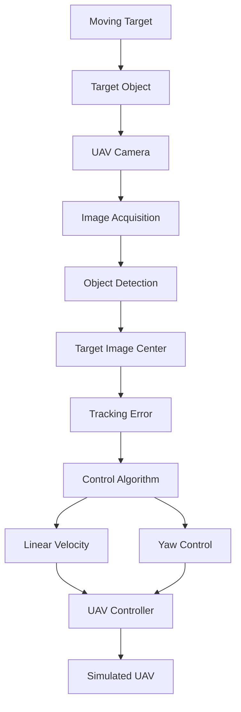
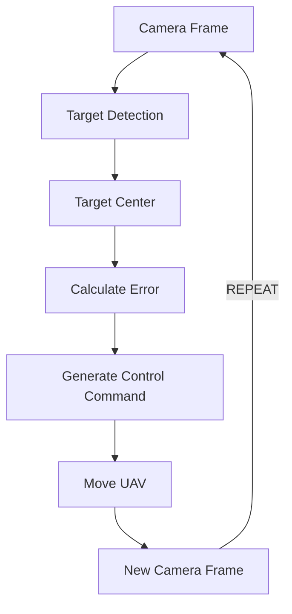
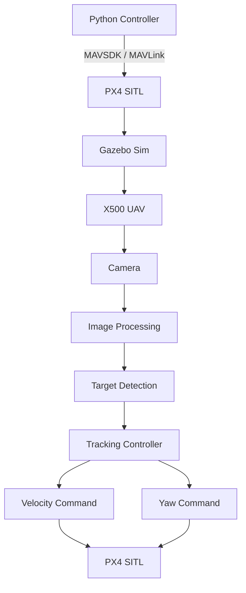
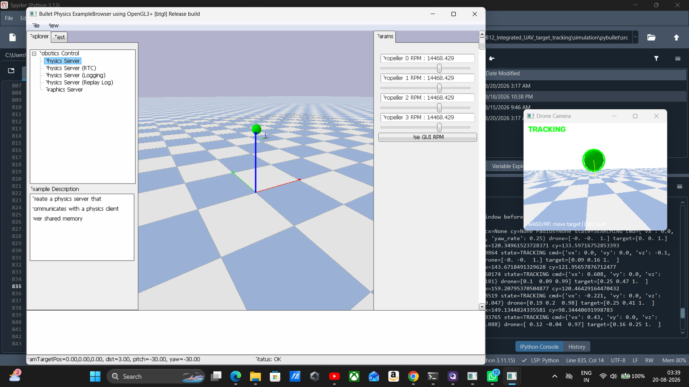
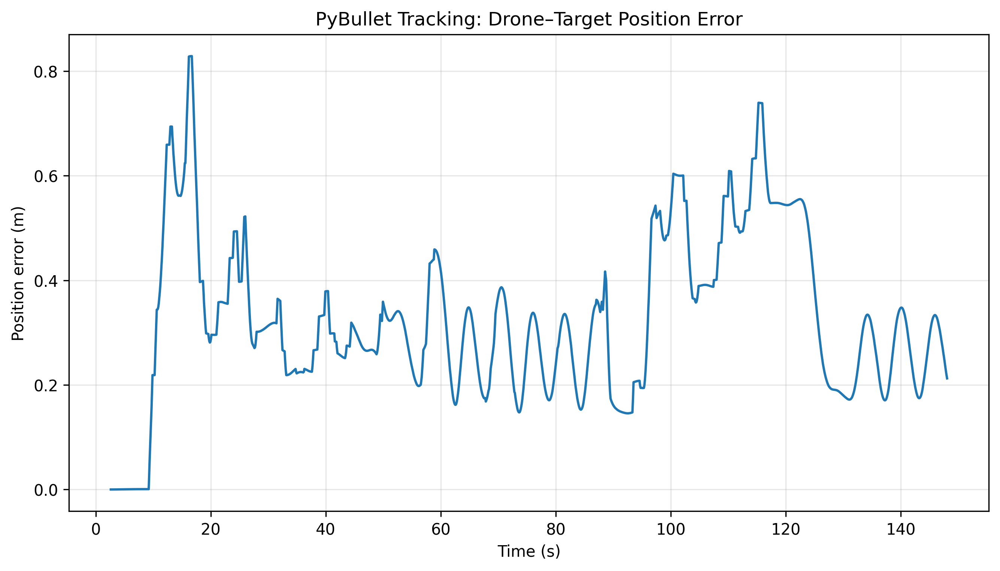
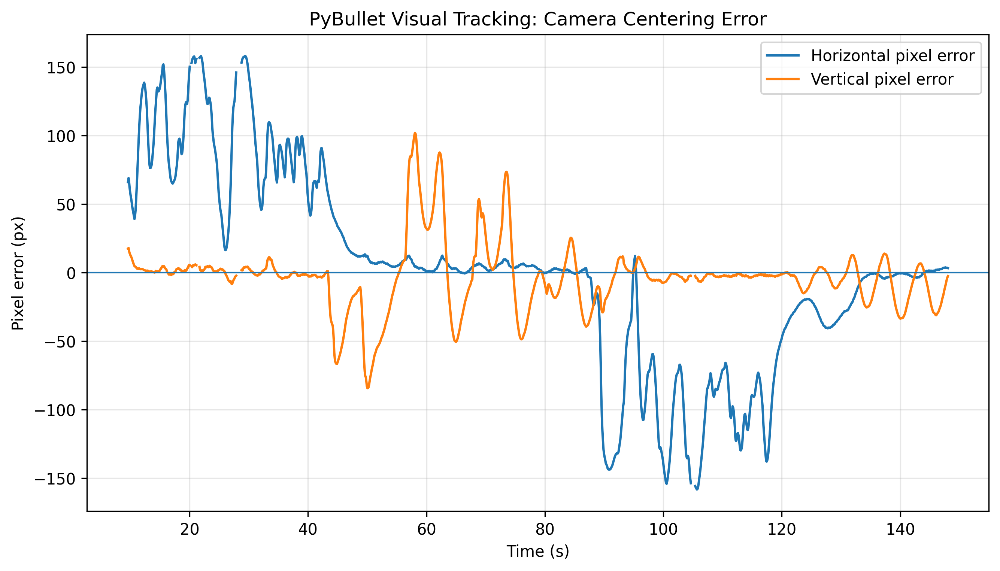
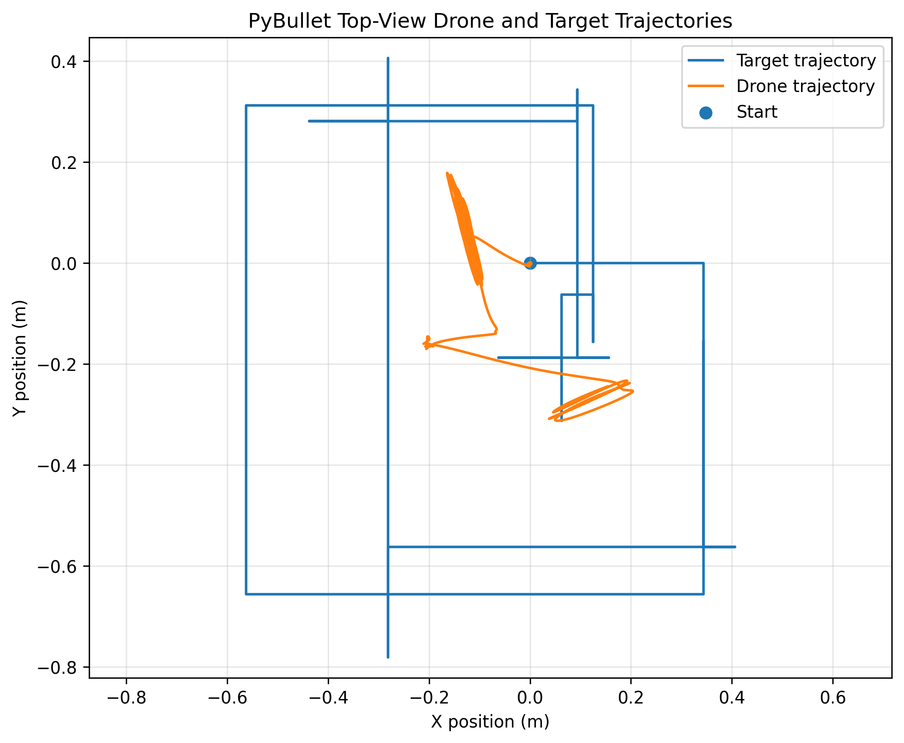
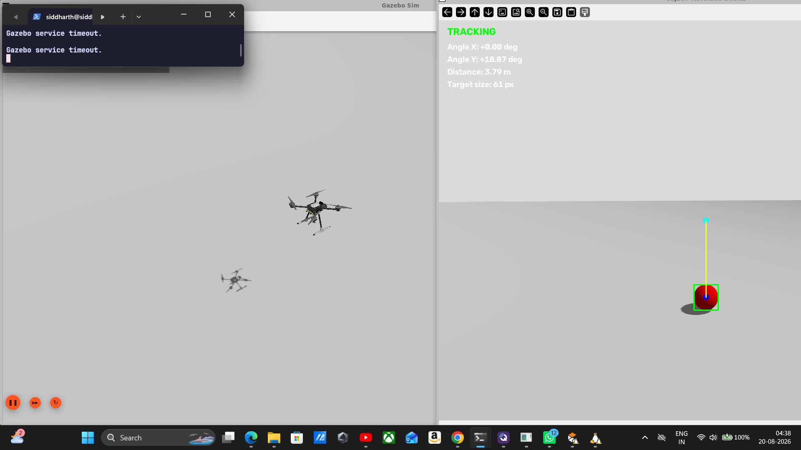

# UAV Object Tracking and Following System

## Drones_S5_AB12_Integrated_UAV_target_tracking

<p align="center">
  
</p>

---

## Team Members

| Name | Roll Number | Email |
|---|---|---|
| Siddharth sankar U | CB.SC.U4AIE24151 | cb.sc.u4aie24151@cb.students.amrita.edu |
| E G Aadhijith | CB.SC.U4AIE24113 | cb.sc.u4aie24113@cb.students.amrita.edu |
| Roahiyaa | CB.SC.U4AIE24043 | cb.sc.u4aie24043@cb.students.amrita.edu |
| Vishnu vardan | CB.SC.U4AIE24159 | cb.sc.u4aie24159@cb.students.amrita.edu |
| Architha Rajasekar | CB.SC.U4AIE24009 | cb.sc.u4aie24009@cb.students.amrita.edu |

---

# Abstract

This project presents the development and simulation of a vision-based
object tracking and following system for an unmanned aerial vehicle (UAV).

The system investigates the ability of a simulated drone to detect a
target using an onboard camera, estimate the target's position within
the camera image, and generate control commands that allow the UAV to
follow and center the target.

Two simulation environments were explored during development:

1. PyBullet
2. PX4 SITL with Gazebo Sim

The PyBullet environment was used for rapid development and testing of
the tracking and control algorithms, while PX4 SITL and Gazebo were used
to investigate a more realistic flight-control architecture.

The project combines computer vision, image processing, camera geometry,
UAV control, and external flight-control interfaces.

---

# 1. Introduction

Unmanned Aerial Vehicles have become increasingly important in
surveillance, inspection, search and rescue, autonomous navigation,
agriculture, and aerial robotics.

One important capability for autonomous UAVs is the ability to detect
and follow a moving target using onboard sensors.

In this project, the UAV observes a target using a camera mounted on
the simulated drone. The detected target location is represented in
image coordinates, and the tracking error between the target and the
camera center is used to generate control commands.

The overall objective is to investigate a complete vision-based UAV
tracking pipeline in simulation before considering physical deployment.

---

# 2. Objectives

The major objectives of the project are:

- Develop a simulated UAV object-tracking system.
- Generate and control a moving target.
- Obtain camera images from the simulated UAV.
- Detect the target using image processing.
- Determine the target position in image coordinates.
- Calculate tracking error between the target and image center.
- Generate UAV movement commands from visual feedback.
- Investigate velocity-based and position-based control.
- Implement UAV control using PX4 SITL.
- Integrate PX4 with Gazebo Sim.
- Investigate external control using MAVSDK and Pymavlink.
- Compare different simulation and control approaches.

---

# 3. Literature Review

## 3.1 Any Object Tracking and Following by a Flying Drone

The first base paper investigates object tracking and following using a
flying drone.

The work provides the theoretical motivation for using visual
information obtained from a UAV-mounted camera to detect and follow
objects.

**Base Paper:**

> Any_Object_Tracking_and_Following_by_a_Flying_Drone

https://ieeexplore.ieee.org/document/7429411

---

## 3.2 Camera Gimbal Control from UAV Autopilot Target Tracking

The second base paper investigates camera/gimbal control and UAV
target tracking.

The work provides relevant background for understanding how target
location relative to the camera can be converted into control
information.

**Base Paper:**

> Camera Gimbal Control from UAV Autopilot Target Tracking

https://www.researchgate.net/publication/282712738_Camera_gimbal_control_from_UAV_autopilot_target_tracking

---

# 4. Research Gap

Existing UAV tracking approaches often depend on specialized hardware,
GPS, gimbal systems, or highly developed autonomous flight platforms.

This project focuses on developing and experimentally evaluating a
simulation-based vision tracking pipeline using accessible simulation
and flight-control technologies.

The project particularly investigates:

- Camera-based target localization.
- Image-center tracking.
- Visual feedback control.
- Velocity-based UAV control.
- PX4 Offboard control.
- Simulation using both PyBullet and Gazebo.
- Integration between computer vision and flight control.

---

# 5. System Architecture

The overall system can be represented as:



---

## 6. Methodology

### 6.1 Target Generation

A target object is introduced into the simulation environment.

The target can be moved through the environment to evaluate whether the UAV tracking controller responds correctly.

---

### 6.2 Camera Acquisition

The UAV obtains image frames using its simulated onboard camera.

For the PX4/Gazebo implementation, the camera image is obtained through the Gazebo transport system.

The camera image is converted into an OpenCV-compatible representation for image processing.

---

### 6.3 Object Detection

The target is detected from the camera image.

For the current experimental implementation, image-processing based detection is used to determine the target location.

The detected target can be represented using:

- Bounding box
- Center coordinates
- Radius/size
- Detection confidence or state

---

## 7. Mathematical Modelling and Derivations for UAV Target Tracking

### 1. System Model

The UAV target-tracking system uses image acquisition, target detection, coordinate error calculation, feedback control, and UAV motion to maintain the target within the camera's field of view.

Let the target position in world coordinates be

$$
\mathbf{p}_T(t)=
\begin{bmatrix}
x_T(t)\\
y_T(t)\\
z_T(t)
\end{bmatrix}
$$

and the UAV position be

$$
\mathbf{p}_D(t)=
\begin{bmatrix}
x_D(t)\\
y_D(t)\\
z_D(t)
\end{bmatrix}
$$

The detected target location in the image plane is

$$
\mathbf{q}_k=
\begin{bmatrix}
c_{x,k}\\
c_{y,k}
\end{bmatrix}
$$

where $c_{x,k}$ and $c_{y,k}$ are the horizontal and vertical coordinates of the detected target centre at time step $k$.

The target-tracking process follows the feedback relationship

$$
\boxed{
\begin{aligned}
&\text{Image Acquisition}
\rightarrow \text{Target Detection}\\
&\rightarrow \text{Error Calculation}
\rightarrow \text{Control}\\
&\rightarrow \text{UAV Motion}
\rightarrow \text{Next Image}
\end{aligned}
}
$$

The objective is to reduce the difference between the target's detected image position and the desired image centre.

---

### 2. Target Motion Modelling

The target trajectory is represented by a time-dependent position function:

$$
\mathbf{p}_T(t)=\mathbf{f}(t)
$$

The specific function depends on the trajectory selected for the target.

### 2.1 Circular Trajectory

For a circular trajectory with radius $R$, centre $(x_c,y_c)$, angular velocity $\omega$, and initial angular position $\theta_0$, the angular position is

$$
\theta(t)=\omega t+\theta_0
$$

The horizontal target coordinates are

$$
\boxed{x_T(t)=x_c+R\cos(\omega t+\theta_0)}
$$

$$
\boxed{y_T(t)=y_c+R\sin(\omega t+\theta_0)}
$$

For a constant target altitude $z_0$,

$$
z_T(t)=z_0
$$

Therefore, the three-dimensional target position is

$$
\mathbf{p}_T(t)=
\begin{bmatrix}
x_c+R\cos(\omega t+\theta_0)\\
y_c+R\sin(\omega t+\theta_0)\\
z_0
\end{bmatrix}
$$

Differentiating the position with respect to time gives the target velocity:

$$
\boxed{
v_{Tx}(t)=-R\omega\sin(\omega t+\theta_0)
}
$$

$$
\boxed{
v_{Ty}(t)=R\omega\cos(\omega t+\theta_0)
}
$$

For constant altitude,

$$
v_{Tz}(t)=0
$$

The horizontal speed is

$$
v_T(t)=\sqrt{v_{Tx}^2(t)+v_{Ty}^2(t)}
$$

Substituting the velocity components,

$$
v_T(t)=
\sqrt{
R^2\omega^2\sin^2(\omega t+\theta_0)
+
R^2\omega^2\cos^2(\omega t+\theta_0)
}
$$

Using the trigonometric identity

$$
\sin^2\theta+\cos^2\theta=1
$$

the horizontal speed becomes

$$
\boxed{v_T=R|\omega|}
$$

The angular velocity determines the direction and rate of rotation, while the radius determines the size of the circular path.

### 2.2 General Target Trajectory

For any differentiable target trajectory,

$$
\mathbf{p}_T(t)=
\begin{bmatrix}
x_T(t)\\
y_T(t)\\
z_T(t)
\end{bmatrix}
$$

the target velocity is

$$
\boxed{
\mathbf{v}_T(t)=\frac{d\mathbf{p}_T(t)}{dt}
}
$$

and its acceleration is

$$
\boxed{
\mathbf{a}_T(t)=\frac{d^2\mathbf{p}_T(t)}{dt^2}
}
$$

These expressions describe the target's motion independently of the UAV's tracking controller.

---

### 3. Image-Based Target Detection

The camera captures an image containing the target. Target detection identifies image pixels that satisfy the selected visual criteria.

### 3.1 HSV Colour Representation

A colour image can be represented in the Hue, Saturation, and Value colour space:

$$
\mathbf{I}_{HSV}(u,v)=
\begin{bmatrix}
H(u,v)\\
S(u,v)\\
V(u,v)
\end{bmatrix}
$$

The variables represent hue, saturation, and brightness at pixel location $(u,v)$.

For a selected colour range, define lower and upper thresholds:

$$
\mathbf{L}=
\begin{bmatrix}
H_{\min}\\
S_{\min}\\
V_{\min}
\end{bmatrix},
\qquad
\mathbf{U}=
\begin{bmatrix}
H_{\max}\\
S_{\max}\\
V_{\max}
\end{bmatrix}
$$

The binary colour mask is

$$
M(u,v)=
\begin{cases}
1, & \mathbf{L}\leq\mathbf{I}_{HSV}(u,v)\leq\mathbf{U}\\
0, & \text{otherwise}
\end{cases}
$$

The inequalities are applied component-wise.

The mask identifies pixels that satisfy the selected colour thresholds.

### 3.2 Bounding Box Representation

If the detected target occupies a rectangular region, its bounding box can be represented by

$$
B=(x_{\min},y_{\min},x_{\max},y_{\max})
$$

The width and height of the bounding box are

$$
w_B=x_{\max}-x_{\min}
$$

$$
h_B=y_{\max}-y_{\min}
$$

The centre of the bounding box is

$$
\boxed{
c_x=\frac{x_{\min}+x_{\max}}{2}
}
$$

$$
\boxed{
c_y=\frac{y_{\min}+y_{\max}}{2}
}
$$

Therefore, the detected image position is

$$
\mathbf{q}=
\begin{bmatrix}
c_x\\
c_y
\end{bmatrix}
$$

### 3.3 Centroid Representation

When the detected target is represented by a binary mask, the centroid can be calculated from the coordinates of the selected pixels.

Let $\Omega$ be the set of detected target pixels and let $N$ be the number of pixels in that set.

The centroid coordinates are

$$
\boxed{
c_x=\frac{1}{N}\sum_{(u,v)\in\Omega}u
}
$$

$$
\boxed{
c_y=\frac{1}{N}\sum_{(u,v)\in\Omega}v
}
$$

where

$$
N=|\Omega|
$$

The centroid and bounding-box centre are alternative representations of the target location; the appropriate method depends on the implementation.

---

### 4. Image Coordinate Error Calculation

The image centre is the desired target location for image-based tracking.

For an image of width $W$ and height $H$, the desired centre is

$$
\mathbf{q}^{*}=
\begin{bmatrix}
W/2\\
H/2
\end{bmatrix}
$$

The detected target position is

$$
\mathbf{q}_k=
\begin{bmatrix}
c_{x,k}\\
c_{y,k}
\end{bmatrix}
$$

The image-coordinate error is defined as the detected position minus the desired position:

$$
\mathbf{e}_k=\mathbf{q}_k-\mathbf{q}^{*}
$$

Expanding the vector gives

$$
\boxed{
e_{x,k}=c_{x,k}-\frac{W}{2}
}
$$

$$
\boxed{
e_{y,k}=c_{y,k}-\frac{H}{2}
}
$$

The error vector is

$$
\mathbf{e}_k=
\begin{bmatrix}
e_{x,k}\\
e_{y,k}
\end{bmatrix}
$$

A zero error means that the detected target centre coincides with the desired image centre.

### 4.1 Normalized Image Error

Pixel errors depend on the image resolution. To express the error relative to the image dimensions, define

$$
\boxed{
e_{x,k}^{n}=\frac{2c_{x,k}-W}{W}
}
$$

$$
\boxed{
e_{y,k}^{n}=\frac{2c_{y,k}-H}{H}
}
$$

The normalized error vector is

$$
\mathbf{e}_k^n=
\begin{bmatrix}
e_{x,k}^{n}\\
e_{y,k}^{n}
\end{bmatrix}
$$

For target coordinates within the image boundaries, each normalized component lies between $-1$ and $1$, assuming the image coordinate convention runs from zero to the corresponding dimension.

Normalization makes the error independent of the numerical scale of the image resolution.

---

### 5. PID Feedback Control

The proportional-integral-derivative controller calculates a control signal from the current error, accumulated error, and rate of error change.

Let $e(t)$ be a tracking error and $u(t)$ be its control output.

### 5.1 Proportional Term

The proportional term depends on the current error:

$$
u_P(t)=K_Pe(t)
$$

where $K_P$ is the proportional gain.

### 5.2 Integral Term

The integral term accumulates error over time:

$$
u_I(t)=K_I\int_0^t e(\tau)\,d\tau
$$

where $K_I$ is the integral gain.

The integral term represents the accumulated tracking error.

### 5.3 Derivative Term

The derivative term depends on how quickly the error changes:

$$
u_D(t)=K_D\frac{de(t)}{dt}
$$

where $K_D$ is the derivative gain.

### 5.4 Complete PID Equation

Combining the three terms gives the continuous-time PID equation:

$$
\boxed{
u(t)=K_Pe(t)+K_I\int_0^t e(\tau)\,d\tau
+K_D\frac{de(t)}{dt}
}
$$

The controller gains determine the contribution of each term.

### 5.5 Discrete-Time PID

In a digital simulation, the controller is evaluated at discrete time steps.

Let $e_k$ be the current error and $\Delta t$ be the time interval between consecutive updates.

The integral term can be approximated by

$$
I_k=I_{k-1}+e_k\Delta t
$$

The derivative term can be approximated by

$$
D_k=\frac{e_k-e_{k-1}}{\Delta t}
$$

The discrete PID output is

$$
\boxed{
u_k=K_Pe_k+K_II_k+K_DD_k
}
$$

Equivalently,

$$
\boxed{
u_k=
K_Pe_k+
K_I(I_{k-1}+e_k\Delta t)+
K_D\frac{e_k-e_{k-1}}{\Delta t}
}
$$

The controller updates its output whenever a new target position is detected.

---

### 6. Mapping Image Error to UAV Commands

The controller must translate image-coordinate error into commands that influence UAV motion.

For horizontal and vertical image errors, separate control signals can be defined as

$$
\begin{aligned}
u_x(t)={}&K_{Px}e_x(t)
+K_{Ix}\int_0^t e_x(\tau)\,d\tau\\
&+K_{Dx}\frac{de_x(t)}{dt}
\end{aligned}
$$

$$
\begin{aligned}
u_y(t)={}&K_{Py}e_y(t)
+K_{Iy}\int_0^t e_y(\tau)\,d\tau\\
&+K_{Dy}\frac{de_y(t)}{dt}
\end{aligned}
$$

These outputs can be combined into a control vector:

$$
\mathbf{u}(t)=
\begin{bmatrix}
u_x(t)\\
u_y(t)
\end{bmatrix}
$$

A general mapping from controller output to a UAV command vector is

$$
\boxed{
\mathbf{v}_{cmd}(t)=\mathbf{G}\mathbf{u}(t)
}
$$

where $\mathbf{G}$ represents the chosen mapping between image-based control signals and UAV command components.

The mapping may include sign changes, scaling, axis selection, or limits according to the coordinate convention and flight-control interface.

**Important:** Image horizontal and vertical errors do not automatically equal world-frame position errors. The mapping depends on the camera orientation, UAV attitude, coordinate frames, and controller design.

---

### 7. UAV Motion Model

The UAV position in world coordinates is

$$
\mathbf{p}_D(t)=
\begin{bmatrix}
x_D(t)\\
y_D(t)\\
z_D(t)
\end{bmatrix}
$$

The corresponding velocity is

$$
\boxed{
\mathbf{v}_D(t)=\frac{d\mathbf{p}_D(t)}{dt}
}
$$

or

$$
\mathbf{v}_D(t)=
\begin{bmatrix}
\dot{x}_D(t)\\
\dot{y}_D(t)\\
\dot{z}_D(t)
\end{bmatrix}
$$

### 7.1 Discrete Position Update

For a discrete simulation with time step $\Delta t$, a first-order position update is

$$
\boxed{
\mathbf{p}_{D,k+1} = \mathbf{p}_{D,k} + \mathbf{v}_{D,k}\Delta t
}
$$

Expanded into individual coordinates,

$$
x_{D,k+1}=x_{D,k}+v_{Dx,k}\Delta t
$$

$$
y_{D,k+1}=y_{D,k}+v_{Dy,k}\Delta t
$$

$$
z_{D,k+1}=z_{D,k}+v_{Dz,k}\Delta t
$$

This update describes motion when the velocity is treated as constant over the time interval.

### 7.2 Acceleration-Based Motion

If acceleration is explicitly modelled, the velocity update is


$$
\boxed{
\mathbf{v}_{D,k+1} = \mathbf{v}_{D,k} + \mathbf{a}_{D,k}\Delta t
}
$$


A corresponding constant-acceleration position approximation is

$$p_{D,k+1}=p_{D,k}+v_{D,k}\Delta t+\frac{1}{2}a_{D,k}(\Delta t)^2$$

These are general discrete-time kinematic models. A physics simulator may instead integrate the UAV's dynamics using its own simulation and control equations.

---

### 8. Camera Projection Model

A camera maps a three-dimensional point into two-dimensional image coordinates.

Let a point in the camera coordinate frame be

$$
\mathbf{P}_C=
\begin{bmatrix}
X_C\\
Y_C\\
Z_C
\end{bmatrix}
$$

Under the pinhole-camera model, its image coordinates are

$$
u=f_x\frac{X_C}{Z_C}+c_x
$$

$$
v=f_y\frac{Y_C}{Z_C}+c_y
$$

where:

- $f_x$ and $f_y$ are focal lengths expressed in pixel units.
- $c_x$ and $c_y$ are the principal-point coordinates.
- $Z_C$ is the depth of the point relative to the camera.

### 8.1 Camera Intrinsic Matrix

The camera intrinsic matrix is

$$
\mathbf{K}=
\begin{bmatrix}
f_x&0&c_x\\
0&f_y&c_y\\
0&0&1
\end{bmatrix}
$$

Using homogeneous coordinates, the projection equation is

`Z_C [u, v, 1]^T = K [X_C, Y_C, Z_C]^T`


This equation relates three-dimensional camera coordinates to two-dimensional image coordinates.

The projection loses direct depth information because the image contains only two spatial coordinates.

### 8.2 Camera Extrinsic Parameters

The transformation from world coordinates to camera coordinates can be represented as

`P_C = R_CW P_W + t_CW`

where:

- $\mathbf{P}_W$ is a point in world coordinates.
- $\mathbf{R}_{CW}$ is the rotation from the world frame to the camera frame.
- $\mathbf{t}_{CW}$ is the translation from the world frame to the camera frame.

The complete camera projection equation is

`Z_C [u, v, 1]^T = K (R_CW P_W + t_CW)`

This equation combines the coordinate-frame transformation with the camera's projection model.

---

### 9. Depth Estimation from Apparent Object Size

Under the pinhole-camera model, the apparent image size of an object depends on its physical size and its distance from the camera.

Let:

- $H_{\mathrm{obj}}$ be the physical height of the object.
- $h_{\mathrm{px}}$ be its apparent height in pixels.
- $f_{\mathrm{px}}$ be the camera focal length in pixels.
- $Z$ be the distance along the camera's optical axis.

For an object approximately perpendicular to the viewing direction,


`h_px = (f_px * H_obj) / Z`

Rearranging gives

$$
\boxed{
Z=
\frac{f_{\mathrm{px}}H_{\mathrm{obj}}}{h_{\mathrm{px}}}
}
$$

This estimate requires knowledge of the object's physical size and the camera's focal length. It is sensitive to bounding-box errors, object orientation, and changes in apparent object size.

---

### 10. Camera-to-World Coordinate Transformation

Let a point in camera coordinates be

$$
\mathbf{P}_C=
\begin{bmatrix}
X_C\\
Y_C\\
Z_C
\end{bmatrix}
$$

Its corresponding world-coordinate position is

$$
\boxed{
\mathbf{P}_W=
\mathbf{R}_{WC}\mathbf{P}_C+
\mathbf{t}_{WC}
}
$$

where:

- $\mathbf{R}_{WC}$ rotates a vector from the camera frame to the world frame.
- $\mathbf{t}_{WC}$ is the camera origin expressed in world coordinates.

If the rotation and translation describe the same rigid transformation used in the world-to-camera equation, then

$$
\mathbf{R}_{WC}=\mathbf{R}_{CW}^{T}
$$

and

$$
\mathbf{t}_{WC}=-\mathbf{R}_{CW}^{T}\mathbf{t}_{CW}
$$

Therefore,

$$
\boxed{
\mathbf{P}_W=
\mathbf{R}_{CW}^{T}
\left(
\mathbf{P}_C-\mathbf{t}_{CW}
\right)
}
$$

The transformation requires a three-dimensional camera-frame point. Image coordinates alone are insufficient to recover a unique three-dimensional world position without additional depth information or assumptions.

---

### 11. Quaternion Representation of Orientation

A quaternion can represent the orientation of the UAV or camera.

The quaternion is written as

$$
\mathbf{q}=
\begin{bmatrix}
q_w\\
q_x\\
q_y\\
q_z
\end{bmatrix}
$$

where $q_w$ is the scalar component and $q_x,q_y,q_z$ are the vector components.

### 11.1 Quaternion Norm

The quaternion norm is

$$
\boxed{
\|\mathbf{q}\|=
\sqrt{q_w^2+q_x^2+q_y^2+q_z^2}
}
$$

A unit quaternion satisfies

$$
q_w^2+q_x^2+q_y^2+q_z^2=1
$$

### 11.2 Quaternion Normalization

For a nonzero quaternion, normalization is

$$
\boxed{
\hat{\mathbf{q}}=
\frac{\mathbf{q}}{\|\mathbf{q}\|}
}
$$

Normalization ensures that the quaternion has unit length.

### 11.3 Quaternion-to-Rotation-Matrix Conversion

For a unit quaternion using the scalar-first convention, the corresponding rotation matrix is

$$
\boxed{
\mathbf{R}(\mathbf{q})=
\begin{bmatrix}
1-2(q_y^2+q_z^2)&2(q_xq_y-q_zq_w)&2(q_xq_z+q_yq_w)\\
2(q_xq_y+q_zq_w)&1-2(q_x^2+q_z^2)&2(q_yq_z-q_xq_w)\\
2(q_xq_z-q_yq_w)&2(q_yq_z+q_xq_w)&1-2(q_x^2+q_y^2)
\end{bmatrix}
}
$$

The resulting matrix can rotate vectors between coordinate frames when the quaternion convention and rotation direction are used consistently.

### 11.4 Quaternion Multiplication

Let two quaternions be

$$
\mathbf{q}_1=(w_1,x_1,y_1,z_1)
$$

$$
\mathbf{q}_2=(w_2,x_2,y_2,z_2)
$$

Their Hamilton product is

$$
\boxed{
\begin{aligned}
w={}&w_1w_2-x_1x_2-y_1y_2-z_1z_2\\
x={}&w_1x_2+x_1w_2+y_1z_2-z_1y_2\\
y={}&w_1y_2-x_1z_2+y_1w_2+z_1x_2\\
z={}&w_1z_2+x_1y_2-y_1x_2+z_1w_2
\end{aligned}
}
$$

Quaternion multiplication combines rotations, with the resulting orientation depending on the multiplication order and coordinate convention.

---

### 12. Relative Position and Distance

The relative position of the target with respect to the UAV is defined as

`p_rel(t) = p_T(t) - p_D(t)`

Expanding the relative position,

`d(t) = sqrt((x_T - x_D)^2 + (y_T - y_D)^2 + (z_T - z_D)^2)`

The Euclidean distance between the target and UAV is

$$
\boxed{
d(t)=\sqrt{
(x_T-x_D)^2+
(y_T-y_D)^2+
(z_T-z_D)^2
}
}
$$

The relative velocity is

$$
\mathbf{v}_{\mathrm{rel}}(t) = \mathbf{v}_T(t) - \mathbf{v}_D(t)
$$

The relative position and distance describe physical separation in the world frame. They are different from image-coordinate error, which describes the target's displacement from the desired image location.

---

### 13. Gaussian Blur

Gaussian blur smooths an image by convolving it with a Gaussian kernel.

For a two-dimensional image $I(x,y)$, the Gaussian function is

$$
\boxed{
G(x,y)=
\frac{1}{2\pi\sigma^2}
\exp\left(
-\frac{x^2+y^2}{2\sigma^2}
\right)
}
$$

where $\sigma$ controls the spread of the Gaussian kernel.

The blurred image is

$$
I_{\mathrm{blur}}(x,y) = (I * G)(x,y)
$$

where $*$ denotes convolution.

Gaussian smoothing reduces high-frequency variations and may reduce image noise before colour segmentation.

---

### 14. Histogram Equalization

Histogram equalization transforms image intensities to redistribute their values across the available intensity range.

For a grayscale image with $L$ possible intensity levels, the cumulative distribution function is

$$
\mathrm{CDF}(r_k) = \sum_{j=0}^{k} p(r_j)
$$

where $p(r_j)$ is the normalized frequency of intensity level $r_j$.

The transformed intensity is

$$
\boxed{
s_k = (L-1)\,\mathrm{CDF}(r_k)
}
$$

The transformation may improve contrast when the image intensity distribution occupies only a limited portion of the available range.

Histogram equalization is an optional image-enhancement operation; its use in a particular tracking pipeline depends on the implementation.

---

### 15. Lucas–Kanade Optical Flow

Optical flow estimates apparent pixel motion between consecutive image frames.

Let image intensity be represented by

$$
I(x,y,t)
$$

Assuming that the intensity of a moving image point remains approximately constant between nearby frames,


$$
I(x,y,t) \approx I(x+\Delta x,y+\Delta y,t+\Delta t)
$$


Using a first-order Taylor expansion,

$$
\begin{aligned}
I(x+\Delta x,y+\Delta y,t+\Delta t)
\approx{}& I(x,y,t)\\
&+I_x\Delta x+I_y\Delta y+I_t\Delta t
\end{aligned}
$$

Subtracting $I(x,y,t)$ and dividing by $\Delta t$ gives

$$
\boxed{
I_xu+I_yv+I_t=0
}
$$

where

$$
u=\frac{\Delta x}{\Delta t},
\qquad
v=\frac{\Delta y}{\Delta t}
$$

and $I_x,I_y,I_t$ are the spatial and temporal image-intensity derivatives.

### 15.1 Least-Squares Solution

The optical-flow equation provides one constraint for two unknown velocity components. The Lucas–Kanade method assumes approximately constant flow in a local image window.

For $n$ pixels in that window, the equations can be written as

$$\mathbf{A}\begin{bmatrix}u\\v\end{bmatrix}=\mathbf{b}$$

where

$$
\mathbf{A}=
\begin{bmatrix}
I_{x,1}&I_{y,1}\\
I_{x,2}&I_{y,2}\\
\vdots&\vdots\\
I_{x,n}&I_{y,n}
\end{bmatrix}
$$

and


$$
\mathbf{b} = -(I_{t,1}, I_{t,2}, \ldots, I_{t,n})^T
$$


The least-squares estimate is


$$
[u, v]^T = (A^T A)^{-1} A^T b
$$


when $\mathbf{A}^{T}\mathbf{A}$ is invertible.

Optical flow can estimate apparent image motion, but it does not directly provide absolute three-dimensional target motion without additional geometric information.

---

### 16. Feedback Tracking Objective

Let the desired target image position be $\mathbf{q}^{*}$ and the detected target position at time step $k$ be $\mathbf{q}_k$.

The tracking error is

$$
\boxed{
\mathbf{e}_k=\mathbf{q}_k-\mathbf{q}^{*}
}
$$

A basic squared-error objective is

$$
\boxed{
J_k=\mathbf{e}_k^{T}\mathbf{e}_k
}
$$

For two image coordinates,

$$
J_k=e_{x,k}^{2}+e_{y,k}^{2}
$$

A tracking controller seeks to reduce this error over successive control updates.

The feedback sequence is

$$
\boxed{
\mathbf{q}_k
\rightarrow
\mathbf{e}_k
\rightarrow
\mathbf{u}_k
\rightarrow
\mathbf{p}_{D,k+1}
\rightarrow
\mathbf{q}_{k+1}
}
$$

The new UAV position affects the next captured image, which produces a new target detection and a new tracking error. This feedback relationship enables the controller to make repeated corrections.

---


### 17. Mathematical Relationship Between the Components

The mathematical components are connected through the following sequence.

1. **Target motion:** The target trajectory determines the target's position over time.

   $$\mathbf{p}_T(t)=\mathbf{f}(t)$$

2. **Image formation:** The camera maps three-dimensional scene points into image coordinates.

   $$Z_C [u, v, 1]^T = K [X_C, Y_C, Z_C]^T$$
  
3. **Target detection:** Image processing estimates the target centre.

$$
\mathbf{q}_k = \begin{bmatrix} u_k \\ v_k \end{bmatrix}^T
$$
   
4. **Error calculation:** The detected position is compared with the desired image centre.

   $$\mathbf{e}_k=\mathbf{q}_k-\mathbf{q}^{*}$$

5. **Feedback control:** The controller calculates a correction from the error.

   $$\mathbf{u}_k=\mathrm{PID}(\mathbf{e}_k)$$

6. **UAV motion:** The control output influences UAV motion through the selected control interface and dynamics.

$$
\mathbf{p}_{D,k+1} = \mathbf{p}_{D,k} + \mathbf{v}_{D,k}\Delta t
$$

7. **Feedback update:** The next image is acquired and processed, producing the next tracking error.

$$
\mathbf{e}_{k+1} = \mathbf{q}_{k+1} - \mathbf{q}^{*}
$$

The overall objective is to reduce the image-position error through repeated detection, control, and motion updates.

---

### 18. Implementation Notes

- The circular trajectory equations apply when the target follows a circular path.
- The image-centre error equations apply when the desired target position is the centre of the image.
- The PID equations describe a general feedback controller. Actual controller gains, update intervals, output limits, and axis mappings must match the implementation.
- The camera projection equations require consistent camera intrinsics and coordinate-frame definitions.
- Depth estimation from apparent size requires a known object dimension and camera focal length.
- Quaternion equations depend on the scalar/vector ordering and the rotation convention used by the implementation.
- Gaussian blur, histogram equalization, and Lucas–Kanade optical flow are supplementary mathematical methods. Include them as implemented project features only if the source code actually uses them.
- The discrete UAV kinematic equations are simplified mathematical models. A physics simulator may use a different integration method and a more detailed dynamics model.
- This document explains the mathematical relationships; it does not by itself establish that every equation is directly implemented in the repository.
- For a source-verified description, match each equation to the corresponding Python implementation in the target-motion, camera-tracking, controller, and simulation files.


## 8. PyBullet Simulation

The first major simulation environment is PyBullet.

The PyBullet implementation provides:

- Simulated UAV
- Simulated target
- Camera
- Target movement
- Image processing
- Tracking logic
- UAV control
- Real-time visualization

The main implementation is located at:

```
simulation/pybullet/
```

---


## 9. PX4 SITL and Gazebo Simulation

The second simulation environment uses PX4 SITL and Gazebo Sim.

The PX4 environment consists of:

- PX4 SITL
- Gazebo Sim
- Simulated X500 UAV
- Simulated onboard camera
- External Python control programs
- QGroundControl

---

## 10. PX4 Flight Control

The project experiments with several types of UAV control:

- Position control
- Velocity control
- Offboard control
- Visual feedback control
- Object-following control

Python programs communicate with PX4 and send commands to the simulated UAV.

---

## 11. Offboard Control

External Python programs are used to control the PX4 vehicle.

Two communication approaches were explored.

### 11.1 MAVSDK

MAVSDK was used for velocity-based control.

For example:

```python
await drone.offboard.set_velocity_body(...)
```

This allows body-frame velocity commands to be transmitted to PX4.

---

### 11.2 Pymavlink

Pymavlink was also investigated for direct MAVLink communication.

Position and velocity setpoints can be transmitted using:

```python
set_position_target_local_ned_send(...)
```

---

## 12. QGroundControl

QGroundControl was used to monitor the PX4 SITL vehicle.

It provides information including:

- Vehicle connection
- Arming state
- Flight mode
- Pre-arm status
- Vehicle position
- Flight status
- PX4 messages

QGroundControl was operated on Windows while PX4 SITL was executed inside the Linux/WSL2 environment.

---

## 13. Camera-Based Tracking

The camera provides the visual feedback required by the tracking controller.

The basic control loop is:



This creates a closed-loop visual feedback system.

## 14. PX4 Simulation Architecture



---

## 15. Results

The developed simulation environments were successfully used to investigate UAV tracking and control.

### 15.1 PyBullet Results

The PyBullet implementation demonstrated:

- UAV simulation
- Camera-based target observation
- Moving target simulation
- Target detection
- Tracking error calculation
- Visual feedback
- UAV movement based on tracking information

**Figures:** 









### PyBullet Quantitative Results

| Metric | Result |
|---|---:|
| Number of recorded samples | 1,547 |
| Mean drone–target position error | 0.329 m |
| RMSE position error | 0.365 m |
| Maximum position error | 0.829 m |
| Mean camera pixel error | 60.58 px |
| RMSE camera pixel error | 74.40 px |
| Maximum camera pixel error | 158.32 px |
| Target detection rate | 94.18% |

### 15.2 PX4/Gazebo Results

The PX4/Gazebo implementation demonstrated:

- Successful PX4 SITL startup
- Successful Gazebo X500 simulation
- Camera image acquisition
- QGroundControl connection
- PX4 arming
- Position control
- Velocity control
- Offboard communication
- Target movement
- Visual tracking experiments

**Figures:** 



## 16. Comparison of Simulation Platforms

| Feature | PyBullet | PX4 + Gazebo |
|---|---|---|
| UAV simulation | Yes | Yes |
| Target simulation | Yes | Yes |
| Camera simulation | Yes | Yes |
| Computer vision | Yes | Yes |
| Position control | Yes | Yes |
| Velocity control | Yes | Yes |
| Flight controller | Custom | PX4 |
| Offboard control | Limited | Yes |
| QGroundControl | No | Yes |
| Realistic autopilot testing | Limited | High |
| Development complexity | Lower | Higher |

## 17. Repository Structure

```
Drones_S5_AB12_Integrated_UAV_target_tracking/

├── README.md
├── simulation/
│   ├── pybullet/
│   │   ├── results/
│   │   └── src/
│   └── px4_gazebo/
│       ├── documentation/
│       ├── models/
│       │   ├── tracker_x500/
│       │   └── tracking_target/
│       ├── results/
│       ├── scripts/
│       └── src/
├── assets/
│   └── screenshots/
├── references/
│   └── papers/
└── team/
```

---


## 18. Verification

The system was considered operational when:

- PyBullet simulation launched successfully.
- PX4 SITL launched successfully.
- Gazebo displayed the X500 UAV.
- QGroundControl detected the simulated vehicle.
- PX4 passed the required pre-flight checks.
- The vehicle could be armed.
- Camera images were successfully obtained.
- Target detection was performed.
- Position commands were successfully tested.
- Velocity commands were successfully tested.
- Offboard communication was successfully tested.

---

## 19. Limitations

The current system is simulation-based.

The project does not yet guarantee performance under real-world conditions involving:

- Lighting variation
- Camera noise
- Wind
- Sensor noise
- Motion blur
- Occlusion
- Complex backgrounds
- Communication delays
- Real UAV dynamics

Further validation using physical UAV hardware would therefore be required.

---

## 20. Future Scope

Future improvements may include:

- Deep-learning based object detection
- YOLO-based target detection
- Multi-object tracking
- Kalman filtering
- PID-based visual servoing
- Improved yaw control
- Camera/gimbal stabilization
- Target distance estimation
- 3D target localization
- Autonomous obstacle avoidance
- Real UAV deployment
- Hardware-in-the-loop testing
- Improved trajectory planning

---

## 21. Conclusion

This project developed and investigated a simulation-based vision tracking system for an autonomous UAV.

Two complementary simulation environments, PyBullet and PX4/Gazebo, were explored.

PyBullet provided a convenient environment for developing and testing the visual tracking and control algorithms, while PX4 SITL and Gazebo provided a more realistic flight-control architecture involving a simulated autopilot.

The project successfully demonstrated the complete concept of obtaining visual information from a UAV camera, detecting a target, calculating the tracking error, and using that information to generate UAV control commands.

The work provides a foundation for future development toward fully autonomous real-world UAV target tracking.

---

## 22. References

1. Any Object Tracking and Following by a Flying Drone. — [*Base Paper Link*](https://ieeexplore.ieee.org/document/7429411)
2. Camera Gimbal Control from UAV Autopilot Target Tracking. — [*Base Paper Link*](https://www.researchgate.net/publication/282712738_Camera_gimbal_control_from_UAV_autopilot_target_tracking)
3. PX4 Documentation — [*PX4 Documentation*](https://docs.px4.io/main/)
4. Gazebo Documentation — [*Gazebo Documentation*](https://gazebosim.org/docs/latest/getstarted/)
5. MAVSDK Documentation — [*MAVSDK Documentation*](https://mavsdk.mavlink.io/main/en/index.html)
6. PyBullet Documentation — [*PyBullet Documentation*](https://pybullet.org/wordpress/)

---

## 23. Project Documentation

Detailed setup and implementation documentation is available in:

- PX4 Setup
- Gazebo Setup
- Camera Setup
- Offboard Control
- Troubleshooting

---

## 24. Project Team

This project was developed by S5 AB12.

Detailed contribution information is available in:

- Team/Contributions.md
